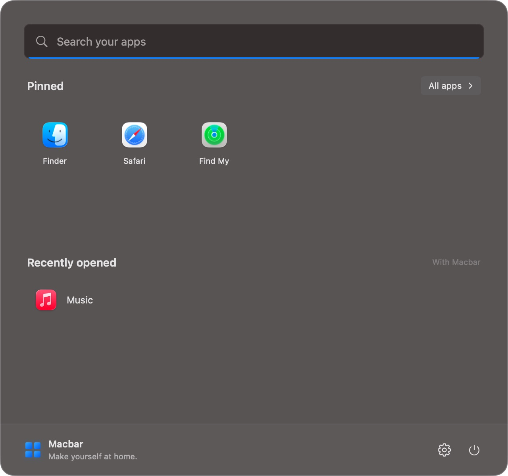
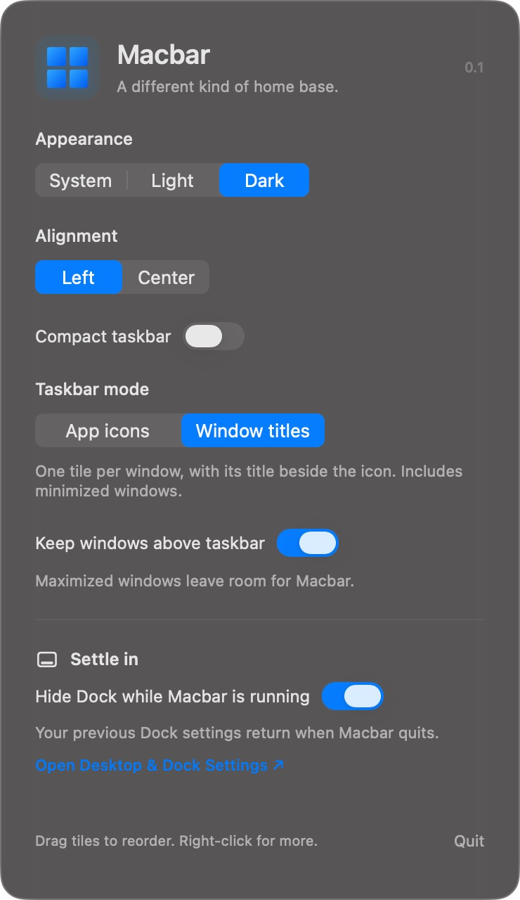

<div align="center">

# Macbar

**A familiar taskbar, made for your Mac.**

Launch apps, switch windows, and keep the controls you use close at hand.<br>
Built natively with SwiftUI and AppKit for macOS 14 and later.


[Get started](#get-started) · [Explore features](#explore-features) · [Permissions](#permissions--privacy) · [Build & test](#build-and-test)

</div>

> **Early experiment:** Macbar is a work in progress, currently intended to be built from source. It does not yet provide a packaged, notarized release or launch at login.

## Meet Macbar

Macbar brings a full-width, glassy taskbar to the bottom of your main display. Pin your favorite apps, switch between open windows, and choose the controls that deserve a place in your tray.

- **Find your flow.** Search installed apps, pin and reorder them, and open Mission Control without leaving the bar.
- **Make windows manageable.** Choose app icons or individual window titles, preview open windows, and arrange a pair side by side.
- **Keep the essentials nearby.** Reach Wi-Fi, sound, input language, battery, CPU, Trash, calendar, and more from the tray.
- **Make it feel like yours.** Pick light or dark, left or center alignment, a compact bar, and which controls are visible.

### A closer look

| App launcher | Settings |
| :---: | :---: |
|  |  |
| Search and open your favorite apps. | Choose your appearance and taskbar layout. |

<sub>These are screenshots of the running app. The taskbar image above is cropped to avoid showing private window titles.</sub>

## Get started

Open **Macbar.xcodeproj**, choose the **Macbar** scheme and **My Mac**, then press **⌘R**. Requires macOS 14 or later and Xcode. The project is configured for Xcode 26.

Or run:

```sh
./scripts/run.sh
```

The script builds with the configured **Apple Development** certificate (team `7RAJ8692JX`), verifies the signature, quits the previous Macbar process, and installs/opens **`/Applications/Macbar.app`**. The build output remains at `build/Build/Products/Debug/Macbar.app`. No ad-hoc signing fallback is used. Grant permissions to the installed copy and use this script for subsequent rebuilds so the signing identity, bundle ID, and installed path stay consistent. Switching from an old ad-hoc build may require granting permissions once more. Xcode builds use the same development signing settings. These settings and the script’s signature check are specific to that team; another developer must configure their own signing identity and update the script’s expected requirement before using it.

It runs as a menu bar app, so it doesn't put another icon in the system Dock. Use its menu bar icon or the taskbar gear for settings and Quit.


## Explore features

| Feature | What you can do |
| --- | --- |
| App launcher | Search, launch, pin, and reorder apps; see which are running. |
| Start menu | A home base beside Search with taskbar favorites, recent and running apps, recent Downloads, folder shortcuts, a saved scratchpad, and quick tools. |
| Window switching | Show individual window titles, restore minimized windows, or hover for previews. |
| Window grouping | Hold left Command and select two tiles to arrange their windows side by side. |
| Desktop controls | Use Wi-Fi, sound, input language, battery, CPU, Trash, clock, and Mission Control. |
| AI limits | See available Codex and Claude subscription usage in the tray. |
| Apple Music | Control playback from the Music tile when the app is running. |
| Personalization | Change appearance, alignment, density, tile mode, and tray order. |

<details>
<summary><strong>Open the complete feature guide</strong></summary>

- **Search:** browse installed apps, search by name, and press Return to launch the first result. Escape or a click outside closes the menu.
- **App icons:** launch or switch to an app. A short line marks running apps; a blue line marks the active app. Right-click to pin, unpin, reveal in Finder, or quit. Extra icons go into an overflow menu.
- **Apple Music special tile:** when Music is running or pinned, its tile includes previous, play/pause, and next controls. While a track is playing, its album artwork replaces the Music icon when available; click it to open Music. If Music does not provide artwork, Macbar searches Apple’s catalog using the track, artist, and album and displays a matching cover. Controls are disabled while Music is closed, and macOS asks for Automation permission the first time Macbar controls it. Playback changes made in Music update the controls.
- **Tile order:** drag an app or window tile to a new position; the tile follows your pointer and the other tiles move aside. Drop outside the app strip to cancel. Use **More applications/windows → Arrange tiles → Move to Start** to bring overflow items into view. Both pinned and unpinned running apps can move without changing whether they are pinned. App order and the pinned launcher order persist across restarts. In Window titles mode, individual windows can be arranged independently, including between other apps; their positions are kept while those windows remain open. Newly created windows appear beside the last tile for their app. Closing all of an app's windows returns its launcher to the same place.
- **Window previews:** hover over a running app icon for 650 ms to see thumbnails of its open windows on the current desktop. Move into the panel to browse them; scroll horizontally for more windows. Click a thumbnail to open the app (and raise that specific window when Accessibility access is enabled). Moving away, clicking elsewhere, or opening another panel closes previews. Pinned apps that aren't running don't show previews. Choose **Allow previews…** in the hover panel to grant Screen Recording access; hovering alone never requests permission. After granting access, hover again (macOS may require restarting Macbar). Minimized/hidden windows aren't included, and unavailable thumbnails show a window placeholder.
- **Window grouping:** hold the left Command key and click an app or window tile to maximize its window on Macbar’s display. Keep holding it and click a second tile to place the first window on the left and the second on the right, each using half the available area. Resize either window at the shared edge and the other follows, keeping the outer edges in place. Linked windows appear as a single divided tile containing both icons; click either to bring both windows forward, or right-click and choose **Ungroup windows**. Release Command to start a new selection. Groups last for the current Macbar session and require Accessibility access. Apps must allow their windows to be moved and resized; native macOS fullscreen windows need to be exited first.
- **Window titles:** choose **Settings → Taskbar mode → Window titles** for the classic Windows-style layout: an icon with the window title on its right, and a separate tile for every window of the same app. Clicking a tile restores and focuses that specific window, including minimized windows. A pinned app is replaced by its window tiles while it has windows open; unopened pinned apps remain as icons, and running apps without windows keep a launcher tile. When crowded, the strip automatically moves left, shortens long titles, and shrinks tile padding and icons. Search becomes an icon if more space is needed. At extreme density, windows keep separate icon tiles before extra windows go into the overflow menu. Hover a shortened tile to read its full title. Requires Accessibility access (use **Allow window access…** in Settings); without it, running apps show their names. Titles update automatically, and the choice persists across restarts. Switch back to **App icons** for grouped icons.
- **Separate multiple windows:** in **App icons** mode, turn on **Separate apps with multiple windows** to show a titled tile for each window when an app has at least two windows, including minimized windows. Click a tile to restore and focus its window. Apps with fewer windows keep a single app icon. This option requires Accessibility access and is off by default.
- **Mission Control:** the overlapping rectangles open macOS Mission Control.
- **Trash:** click the tray icon to open Finder’s Trash. Right-click it and choose **Empty Trash…** to permanently delete its contents after confirmation. Finder Automation permission may be requested.
- **Clock:** a live clock and month calendar, using your system locale and time zone.
- **Wi-Fi:** a nearby-network list with the connected network first, signal strength, refresh, and password entry for joining personal networks. Enterprise networks open Wi-Fi settings. macOS requires Location permission to reveal network names; choose **Allow network discovery** in the panel. Network names and passwords are not saved by Macbar.
- **Keyboard input:** the right-hand tray shows the current language or layout (for example, ABC, EN, RU, or LV). Click it to select an enabled macOS input source; a checkmark identifies the active source. The indicator follows changes made with keyboard shortcuts, macOS, or app-specific input sources. **Keyboard Settings…** opens macOS settings to manage the available sources. Switching keeps focus in the app you were using and requires no extra permissions.
- **Hidden tray icons:** drag a right-side control onto the chevron to move it into the hidden-icons drawer. Click the chevron to open it and drag a control back to the tray. Right-click a control for the same options. Drawer placement persists across restarts; controls disabled in settings stay disabled.
- **Tray order:** drag any right-side control (AI limits, input language, Wi-Fi, Sound, Battery, CPU, Clock, Trash, or Settings) between the others. The control follows your pointer while neighbors make room. Drop outside the tray or press Escape to cancel. Ordinary clicks still open the control, and the order persists across restarts. Hidden controls keep their place when shown again.
- **Show/hide controls:** right-click empty taskbar space for a small checked list of Input Language, Wi-Fi, Sound, Battery, CPU, Clock, Trash, Search, Mission Control, and AI Limits. Choices persist across restarts, and hidden controls return their space to app tiles. The settings button stays available.
- **AI limits:** the right-hand tray shows Codex and Claude subscription usage remaining. Click for session/weekly windows, model-specific limits when available, reset times, and Refresh. Claude keeps its last known value if a refresh fails or a reset time passes; the panel marks it as last known. A dash means no usable reading is available. Codex uses the locally installed Codex CLI and its ChatGPT sign-in. Claude reads your existing Claude Code sign-in; if Keychain access is needed, click **Allow Claude access…** in the panel. Background updates never ask for Keychain access. Values refresh every three minutes while the control and taskbar are shown; hiding AI Limits stops its polling. Macbar keeps snapshots only in memory, never saves tokens, and never makes model-generation requests. See [AI limits integration](docs/AI_LIMITS.md) for sources and supported account states.
- **CPU:** the tray shows overall CPU usage across all cores, updated every two seconds, with a bottom-filling meter that moves from green through yellow to red at 95%. Click it for the CPU user and system breakdown, RAM in use, and used space on the home disk. RAM usage includes active, wired, and compressed memory. Disable it from the taskbar context menu or move it into hidden icons. Sampling stops when the control or taskbar is hidden.
- **Battery:** a live charge-level icon beside Sound, with a green bolt while charging and a red indicator at 20% or less on battery power. Click for the exact percentage, charging status, power source, and Battery Settings. It follows macOS power-source notifications without polling or extra permissions, and hides automatically on Macs without a built-in battery.
- **Sound:** a live system volume slider and mute button for the current output. Changes made with your keyboard or in macOS are reflected here. Outputs that don't support software volume (such as some HDMI devices) show a disabled slider and a settings shortcut.
- **Settings:** system/light/dark appearance, Left/Center alignment, compact mode, app icons or separate window tiles, and app labels in icon mode. Alignment applies to the app strip and launcher; the system tray stays on the right. Preferences and pins persist on this Mac. Recent apps are kept only for the current session.
- **Start:** the first button in the app strip glows on hover and opens favorites, recent and running apps, Home/Downloads/Documents/Applications, and quick tools for showing the desktop, opening Screenshot, and Calculator. **Recent files in Downloads** shows the four newest completed files, sorted by the date added to the folder, with file size, open, and Reveal in Finder actions; it refreshes whenever Start opens and reads only folder metadata. Hidden files, subfolders, symbolic links, and unfinished downloads are excluded. Its scratchpad saves automatically on this Mac and includes a Copy button. **All apps** opens Search. Start and Search can be shown or hidden independently from the taskbar context menu.
- **Keep windows above taskbar:** enabled by default. In Macbar settings choose **Allow window management…**, then enable Macbar in **System Settings → Privacy & Security → Accessibility**. A maximized normal window on the taskbar's display is shortened to end exactly above the bar. Smaller windows, half-screen tiles, dialogs, other displays, and native fullscreen windows are left alone. Turning this setting off or hiding Macbar stops future adjustments; it does not restore old window sizes. Switching to compact mode returns the extra space to windows Macbar previously adjusted.

Enable **Hide Dock while Macbar is running** in Macbar settings to keep the Dock out of the way. Macbar restores your previous Dock settings when it quits, including after an unexpected exit. The Dock remains part of macOS, and Macbar also links to Desktop & Dock settings.


</details>

## Permissions & privacy

Macbar starts without requiring every permission. macOS asks for access when you choose a feature that needs it:

| Permission | Used for | How to enable it |
| --- | --- | --- |
| Accessibility | Window titles, focusing, grouping, and automatic window fitting. | Choose **Allow window access…** or **Allow window management…** in Macbar settings. |
| Screen Recording | Capturing optional window-preview thumbnails. | Choose **Allow previews…** in the preview panel. |
| Location | Discovering nearby Wi-Fi network names. | Choose **Allow network discovery** in the Wi-Fi panel. |
| Automation | Controlling playback in Apple Music and opening or emptying Trash in Finder. | macOS asks when Macbar first controls each app. |
| Keychain access | Reading Claude Code credentials when needed for usage limits. | Choose **Allow Claude access…** in the AI limits panel. |

Preview thumbnails remain in memory while the panel is open. Wi-Fi names and passwords are not saved by Macbar. AI usage snapshots stay in memory; the Claude integration sends the existing access token to Anthropic's usage endpoint. See [AI limits integration](docs/AI_LIMITS.md) for details.

## How it fits on your desktop

The taskbar occupies the full width at the bottom of the main display and follows normal desktop Spaces. It hides automatically when an app or video covers that display, and returns when full screen ends. A taskbar hidden manually remains hidden. It uses a nonactivating panel, so clicking its background doesn't take focus away from the app you're using. Popups support keyboard focus. App discovery runs off the main thread and scans application folders only.

This is an experimental floating taskbar: **it doesn't change the system's work area**. Instead, the optional window-management feature uses public Accessibility APIs to adjust the active maximized window after it grows behind Macbar. Apps may briefly show their original size before correction. Apps that don't expose standard, resizable windows or a fullscreen state are skipped; rejected resize requests aren't repeated while the window and taskbar remain unchanged. It does not appear over exclusive fullscreen apps or install itself at login. Screen Recording permission is optional and used only for window previews, captured with public ScreenCaptureKit APIs. Thumbnails stay in memory while the preview panel is open and are never saved or transmitted. Accessibility access is used for window management, listing window tiles, restoring and focusing selected windows, and raising a selected preview window; Location access is requested only from the Wi-Fi panel. Window enumeration runs off the main thread only while window tiles and the taskbar are enabled. The app does not request coordinates, record location, or transmit window information or network names.


## Build and test

```sh
xcodebuild -project Macbar.xcodeproj -scheme Macbar \
  -destination 'platform=macOS' -derivedDataPath build build
xcodebuild -project Macbar.xcodeproj -scheme Macbar \
  -destination 'platform=macOS' -derivedDataPath build test
```

Tests cover app search, preferences, display/popup/window-fitting geometry, calendar alignment/leap years, Wi-Fi list deduplication, and audio control behavior with a simulated output (no system volume changes during tests). Window-tile tests cover mode persistence, separate windows with identical or empty titles, pinned-app replacement, minimized/focused state, overflow sizing, permission loss, and cancellation when switching modes. Preview tests use simulated captures to check permission handling, app switching, cancellation during enumeration and capture, capture failures, empty lists, and display-edge positioning. Window-fitting tests cover fullscreen/dialog exclusions, smaller and tiled windows, additional displays, Dock insets, coordinate conversion, repeat checks, compact mode, and manual resizing. The Xcode project is checked in. If editing `project.yml`, regenerate it with [XcodeGen](https://github.com/yonaskolb/XcodeGen): `xcodegen generate`.


## Project guide

- [AI limits integration](docs/AI_LIMITS.md) — data sources, sign-in, and refresh behavior.
- [Product readiness](docs/PRODUCT_READINESS.md) — current limitations and work needed before a broader release.
- [Project configuration](project.yml) — XcodeGen settings and signing configuration.
